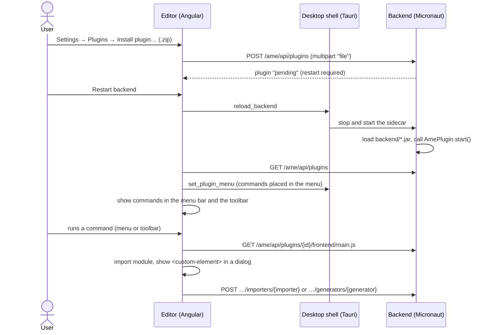

# Aspect Model Editor

## Table of Contents

- [Introduction](#introduction)
- [Getting help](#getting-help)
- [Getting started](#getting-started-for-developers)
  - [Setup](#setup)
  - [Install & Run](#install--run-web-only)
  - [Backend for the desktop app](#backend-for-the-desktop-app)
  - [Run As Desktop (Tauri)](#run-as-desktop-tauri)
  - [Build Desktop App](#build-desktop-app)
  - [Release](#release)
  - [Running E2E (Playwright) Tests](#running-e2e-playwright-tests)
- [External editors (VS Code)](#external-editors-vs-code)
- [Plugins](#plugins)
- [Documentation](#documentation)
- [License](#license)

## Introduction

This project includes the Aspect Model Editor and its documentation.
As a user, download the Installer from https://github.com/eclipse-esmf/esmf-aspect-model-editor/releases .

## Getting help

Are you having trouble with Aspect Model Editor? We want to help!

- Check the [developer documentation](https://eclipse-esmf.github.io)
- Check the
  SAMM [specification](https://eclipse-esmf.github.io/samm-specification/2.2.0/index.html)
- Having issues with the Aspect Model Editor? Open
  a [GitHub issue](https://github.com/eclipse-esmf/esmf-aspect-model-editor/issues).

### Getting started (for developers)

#### Artifacts to use

You can clone the repositories to run the aspect model editor. Feel free to contribute.
If you want to run the aspect model editor from repositories, please ensure to clone and start the [backend](https://github.com/eclipse-esmf/esmf-aspect-model-editor-backend) first.

#### Setup

Common prerequisites for all platforms:

- [Node.js](https://nodejs.org/en/download/) 22 (LTS) and [pnpm](https://pnpm.io/installation) (`npm install -g pnpm`)
- [Rust & Cargo](https://rustup.rs/) (stable toolchain, required for the Tauri desktop app)
- To generate Aspect Model documentation, the installation of [GraphViz](https://graphviz.org/download) is required.

Platform-specific prerequisites for the Tauri desktop app (see also the [Tauri prerequisites](https://v2.tauri.app/start/prerequisites/)):

| Platform | Requirements                                                                                                                                                                                                                                  |
|----------|-----------------------------------------------------------------------------------------------------------------------------------------------------------------------------------------------------------------------------------------------|
| macOS    | Xcode Command Line Tools: `xcode-select --install`                                                                                                                                                                                            |
| Linux    | WebKitGTK and build tools, e.g. on Debian/Ubuntu:<br>`sudo apt install libwebkit2gtk-4.1-dev build-essential curl wget file libxdo-dev libssl-dev libayatana-appindicator3-dev librsvg2-dev libdbus-1-dev patchelf`                                         |
| Windows  | [Microsoft C++ Build Tools](https://visualstudio.microsoft.com/visual-cpp-build-tools/) (workload "Desktop development with C++") and [WebView2](https://developer.microsoft.com/microsoft-edge/webview2/) (preinstalled on Windows 10/11) |

#### First steps into the code: [Code Overview](CODE-OVERVIEW.md)

#### Install & Run (Web only)

```bash
# enter the core directory where package.json is located
cd core

pnpm install
pnpm run start
```

The editor is then available at http://localhost:4200 and expects a running [backend](https://github.com/eclipse-esmf/esmf-aspect-model-editor-backend) on port `9090`.

#### Backend for the desktop app

The desktop app bundles the backend as a [jpackage](https://docs.oracle.com/en/java/javase/21/docs/specs/man/jpackage.html) app image.
Release builds take it from the platform-specific folder in the repository root:

| Platform | Folder             | Expected content (from the backend release)                           |
|----------|--------------------|-----------------------------------------------------------------------|
| macOS    | `backend/macos/`   | `ame-backend-<version>-mac-<arch>.app` (extracted from `*-mac-arm64.tar.gz` on Apple silicon or `*-mac-x64.tar.gz` on Intel) |
| Linux    | `backend/linux/`   | `ame-backend-<version>-linux/bin/...` (extracted from `*-linux.tar.gz`) |
| Windows  | `backend/windows/` | app image containing `ame-backend*.exe` (extracted from `*-win.zip`)  |

The folder is only needed for release builds (`pnpm run build:tauri`), which fail with a hint if it is missing.
They add it as bundle resource via `core/src-tauri/tauri.bundle-backend.<os>.conf.json` (see `core/utils/tauri-build.mjs`) and start the bundled backend automatically.
Use this script instead of `tauri build` directly, otherwise the backend is missing in the app.

In development mode (`pnpm run start:desktop`) the folder is not required and the bundled backend is **not** started; the app expects a backend that you started yourself on port `9090`.

#### Run As Desktop (Tauri)

To run the desktop application in development mode (starts the Angular dev server and the native Tauri window with hot reload).
The command is the same on macOS, Linux and Windows:

```bash
cd core

pnpm install
pnpm run start:desktop
```

Make sure the backend is running on port `9090` before working with models (see above).

#### Build Desktop App

Desktop packages must be built on the target platform (no cross-compilation). The command builds the Angular production bundle and the Tauri app in one step:

```bash
cd core

pnpm run build:tauri
```

On Linux the script sets `NO_STRIP=true`, because the `strip` bundled with the AppImage tooling fails on libraries of current distributions.

The bundles for the current platform are written to `core/src-tauri/target/release/bundle/`:

| Platform | Output                                                                           |
|----------|----------------------------------------------------------------------------------|
| macOS    | `macos/Aspect Model Editor.app` and `dmg/Aspect Model Editor_<version>_<arch>.dmg` |
| Linux    | `appimage/*.AppImage` and `deb/*.deb`                                            |
| Windows  | `nsis/*-setup.exe` (per-user NSIS installer)                                     |

The backend app image contains its own Java runtime and therefore matches the processor architecture: use the `mac-arm64` backend for Apple silicon builds and the `mac-x64` backend for Intel builds.

Unsigned macOS builds may be blocked by Gatekeeper. Remove the quarantine flag with
`xattr -rd com.apple.quarantine "/Applications/Aspect Model Editor.app"`.

On Linux (AppImage and `.deb`) the app sets `WEBKIT_DISABLE_DMABUF_RENDERER=1` at startup, because the DMA-BUF renderer of WebKitGTK shows a blank window with several GPU drivers (e.g. NVIDIA, virtual machines). An explicitly set value is kept.
If the window still stays blank or flickers, start the app with `WEBKIT_DISABLE_COMPOSITING_MODE=1` (slower rendering), e.g. `WEBKIT_DISABLE_COMPOSITING_MODE=1 ./Aspect-Model-Editor.AppImage`.

#### Release

The workflow `.github/workflows/tagged_release.yml` (manually started with the release version) creates the release.
The backend release with the same version must exist before (repository `esmf-aspect-model-editor-backend` of the same owner, so a fork uses the backend release of the fork).

1. `prepare` sets the documentation version, creates the branch `<major>.<minor>.x`, the tag `v<version>` and a draft release. Release candidates (e.g. `2.3.0-rc1`) become a pre-release.
2. `build` builds the app on every platform with the matching backend and uploads it to the draft release:

   | Runner           | Release assets                                                                                     |
   |------------------|----------------------------------------------------------------------------------------------------|
   | `ubuntu-latest`  | `aspect-model-editor-v<version>-linux-glibc-v<glibc>.AppImage`, `aspect-model-editor-v<version>-linux-amd64.deb` |
   | `macos-15-intel` | `aspect-model-editor-v<version>-mac-x64.dmg`                                                       |
   | `macos-latest`   | `aspect-model-editor-v<version>-mac-arm64.dmg`                                                     |
   | `windows-latest` | `aspect-model-editor-v<version>-win.exe` (workflow artifact only, signed and uploaded by Jenkins)  |

3. `publish` publishes the release and triggers the Jenkins job which signs the Windows installer.
   The Jenkins job is only triggered in the repository `eclipse-esmf`, so the workflow can be tested in a fork.

#### Running E2E (Playwright) Tests

```bash
cd core

# Run all E2E tests headless
pnpm run e2e

# Run with interactive UI
pnpm run e2e:ui

# Run headed
pnpm run e2e:headed
```

## External editors (VS Code)

The editor opens the workspace, a namespace folder, a file or the declaration of a model element in VS Code or a
compatible editor (VS Code Insiders, Cursor, VSCodium; see *Settings > Open in external editor*). It also reloads the
workspace when `.ttl` files are changed outside the editor and asks, once the editor window has the focus again, whether
to reload the affected open models (*Settings > Reload models automatically after external changes* reloads them right
away instead).

| Part | Location |
|------|----------|
| URL and path helpers (`vscode://file/...`, Windows/UNC paths) | `libs/shared/src/lib/common/external-editor/` |
| Commands: open file, folder, element, workspace | `libs/domain/src/lib/state/external-editor/` |
| Desktop launcher: URL scheme → CLI `--goto` (`code.cmd` on Windows) → OS default | `src-tauri/src/external_editor.rs` |
| Element position (`GET /models/location?fileName=`, the loaded file declaring the element wins) | `ModelApiService.getElementLocation` |
| Text view: toolbar button, Ctrl/Cmd+click with link underline and gutter icon per definition (`elementRangeAt`, `elementDefinitionOffsets`, `enclosingSubjectAt`) | `libs/editor/src/lib/text-view/` |
| Change events (`GET /workspaces/events`, Server-Sent Events via `fetch`, token header, retry with backoff) | `libs/infrastructure/src/lib/api/workspace-events-api.service.ts` |
| Reload dialog for affected tabs (also tabs referencing a changed file), shown when the window has the focus; optional automatic reload of clean tabs | `libs/editor/src/lib/external-changes/` |

The backend side is described in the backend README. User documentation:
[Work with VS Code](documentation/ame-guide/modules/ROOT/pages/getting-started/external-editor.adoc).

## Plugins

Plugins extend the desktop app without rebuilding it, e.g. with an importer for another format or a generator that
creates files from the open Aspect Model. A plugin is a `.zip` archive with a backend part (Java, runs in the editor
backend) and/or a user interface (a Web Component shown in the editor). Users install it under
*Settings → System configuration → Plugins*; the user guide describes this in
[Plugins](documentation/ame-guide/modules/ROOT/pages/plugins/plugins.adoc).

The backend repository contains two complete, buildable examples, one per plugin type:

| Example | Type | What it does |
|---------|------|--------------|
| [`examples/import-plugin`](https://github.com/eclipse-esmf/esmf-aspect-model-editor-backend/tree/main/examples/import-plugin) | import | Creates an Aspect Model from a JSON description of an Aspect (*File → Import* and toolbar). |
| [`examples/generator-plugin`](https://github.com/eclipse-esmf/esmf-aspect-model-editor-backend/tree/main/examples/generator-plugin) | generator | Generates a JSON description of the Aspect of the open Aspect Model (*Generate* and toolbar). |

A plugin may also combine both types; the examples are separated to keep each of them small.

Both examples contain samples to try them out:

- `examples/import-plugin/samples/movement.json`: a JSON description to import with *File → Import → Import from JSON description...*.
- `examples/generator-plugin/samples/Movement.ttl`: an Aspect Model to open; *Generate → Generate as JSON description...* saves
  `Movement.description.json`, which equals `examples/generator-plugin/samples/Movement.description.json`.

The tests of the examples check that the samples stay valid and that the generator produces exactly the sample output.

### What plugins can do

A plugin contributes *commands*. The editor knows two kinds of commands; each one opens the user interface of the
plugin in a dialog:

| Kind       | Purpose                                                       | Works on                              | Result                                                    |
|------------|---------------------------------------------------------------|---------------------------------------|-----------------------------------------------------------|
| `import`   | Creates Aspect Models from something else, e.g. a file        | Input chosen in the plugin dialog     | New models, opened in the editor (unsaved)                |
| `generate` | Creates files from the open Aspect Model, e.g. an export      | Read-only copy of the open model      | Files the user saves (download/save dialog)               |

The manifest decides where a command appears: in the menu bar, in the toolbar (the *Plugins* button), in the context
menu of a shape (right click), or in any combination of them.

The backend part offers the logic through three fixed building blocks: **importers** (a file in, Aspect Models out),
**generators** (an Aspect Model in, files out) and free-form **actions** (JSON in, JSON out, e.g. to validate input or
to read the workspace while the user fills in the dialog).

#### No own REST endpoints

Plugins do not register their own REST endpoints. The backend offers one fixed, token-protected endpoint per building
block (see [REST API](#rest-api)) and routes the call to the importer, generator or action of the plugin by its id. The
user interface never calls these endpoints directly but through the host API (`host.backend.importModel`,
`host.backend.generate`, `host.backend.action`). This keeps authentication, error handling, limits and the API version
in the editor and lets plugins be updated without changes to the editor.

#### Restrictions

| Area                | Restriction                                                                                                         |
|---------------------|---------------------------------------------------------------------------------------------------------------------|
| Editor model        | Plugins cannot change the open model. Generators get a frozen copy; importers can only open *new*, unsaved models. |
| Workspace           | The backend part can read models of the workspaces (`WorkspaceAccess`); it cannot save into them via the API.       |
| Command kinds       | Only `import` and `generate`. Every command opens the plugin's dialog; commands without user interface are not possible. |
| Placements          | `menu` and `toolbar`. `generate` commands are disabled in both while no Aspect Model is open.                      |
| Menus               | Only *File → Import*, *Generate* or the own *Plugins* menu; no new top-level menus.                                  |
| Toolbar             | All commands share one *Plugins* button with a drop-down; plugins cannot add buttons of their own.                  |
| Generated files     | Plain file names without directories; the desktop application asks the user where to save them.                     |
| User interface      | One ES module from a `blob:` URL: bundle all code; load further files with `host.resource()`.                       |
| Backend part        | Own class loader; shares only the plugin API, the SLF4J API and the Java runtime. Calls are synchronous.            |
| Lifecycle           | Changes take effect after a restart of the backend; a new user interface after a restart of the application.         |
| Desktop app only    | Plugins run in the desktop app (Tauri). In the browser, plugins can be managed but no commands are shown.           |

#### Possible future extensions

These restrictions keep the first plugin API small and stable. Extensions that fit into the design, each with a new
`pluginApiVersion` or as optional fields:

- further command kinds, e.g. `validate` or commands that run without dialog (backend only),
- changing the open model through a reviewed change set (with undo),
- events, e.g. when a model is opened, saved or validated,
- a settings page per plugin in the settings dialog,
- long-running jobs with progress and cancellation,
- saving generated files directly into a workspace,
- own sub-routes per plugin below `/ame/api/plugins/{id}/…` if the fixed building blocks are not enough.

### Lifecycle



- Plugins are loaded when the backend starts. Installing, updating, enabling, disabling and removing a plugin takes
  effect after a restart of the backend, which the settings offer as a button. Removing a running plugin restarts the
  backend right away, because its classes stay loaded until then. Open models stay open.
- A plugin that fails to start is shown as *Failed* with its error; the editor starts anyway.
- Installing a plugin with the id of an installed one updates it; its data directory is kept.
- Plugins are stored in `~/aspect-model-editor/plugins`.

### Archive layout

```
example-generator-1.0.0.zip
├── plugin.json              manifest, required, at the root of the archive
├── backend/                 optional: the backend part
│   ├── example-generator.jar  JAR(s) with the AmePlugin implementation
│   └── lib/                 libraries of the plugin (all JARs below backend/ are on its class path)
│       └── jackson-databind-2.x.jar
└── frontend/                optional: the user interface
    ├── main.js              a single ES module defining the custom element
    └── assets/logo.svg      further files, loaded with host.resource('assets/logo.svg')
```

A plugin has a backend part, a user interface or both. Limits: at most 10,000 entries and 512 MB extracted, 100 MB per upload; entries
outside the archive root (`../`) are rejected.

### `plugin.json`

Import plugin (`examples/import-plugin`):

```json
{
  "id": "example-import",
  "name": "Example Import",
  "version": "1.0.0",
  "pluginApiVersion": 1,
  "description": "Example import plugin: creates Aspect Models from a JSON description of an Aspect.",
  "frontend": {
    "entry": "frontend/main.js",
    "element": "ame-plugin-example-import"
  },
  "contributions": {
    "commands": [
      {
        "id": "import",
        "kind": "import",
        "label": "Import from JSON description...",
        "labels": {"de": "Aus JSON-Beschreibung importieren...", "zh": "从 JSON 描述导入..."},
        "icon": "upload_file",
        "placements": ["menu", "toolbar"],
        "menu": "file/import"
      }
    ]
  }
}
```

Generator plugin (`examples/generator-plugin`):

```json
{
  "id": "example-generator",
  "name": "Example Generator",
  "version": "1.0.0",
  "pluginApiVersion": 1,
  "description": "Example generator plugin: generates a JSON description of the Aspect of the open Aspect Model.",
  "frontend": {
    "entry": "frontend/main.js",
    "element": "ame-plugin-example-generator"
  },
  "contributions": {
    "commands": [
      {
        "id": "generate",
        "kind": "generate",
        "label": "Generate as JSON description...",
        "labels": {"de": "Als JSON-Beschreibung generieren...", "zh": "生成 JSON 描述..."},
        "icon": "output",
        "placements": ["menu", "toolbar"],
        "menu": "generate"
      }
    ]
  }
}
```

| Field                                 | Required        | Rules                                                                                                       |
|---------------------------------------|-----------------|-------------------------------------------------------------------------------------------------------------|
| `id`                                  | yes             | 2–63 lowercase letters, digits and `-`, starting with a letter or digit, e.g. `example-import`. Identifies the plugin; installing the same id again updates it. |
| `name`                                | yes             | Shown in the settings.                                                                                      |
| `version`                             | yes             | Letters, digits, `.`, `+`, `_`, `-`, e.g. `1.0.0`.                                                          |
| `pluginApiVersion`                    | yes             | The plugin API the plugin was built for; this editor supports `1`. Other versions are rejected.           |
| `description`                         | no              | Shown in the settings.                                                                                      |
| `frontend.entry`                      | with `frontend` | A `.js` file below `frontend/`, e.g. `frontend/main.js`.                                                    |
| `frontend.element`                    | with `frontend` | The custom element the module defines; must contain a hyphen, e.g. `ame-plugin-example-import`.                   |
| `contributions.commands[].id`         | yes             | Unique within the plugin; letters, digits, `.`, `_`, `-` (max. 64). Passed to the user interface as `host.commandId`. |
| `contributions.commands[].kind`       | yes             | `import` or `generate`. Passed to the user interface as `host.kind`.                                        |
| `contributions.commands[].label`      | yes             | Label in the menu, the toolbar and the title of the dialog.                                                 |
| `contributions.commands[].labels`     | no              | Translations by language code (`en`, `de`, `zh`); `label` is used for missing languages.                    |
| `contributions.commands[].icon`       | no              | Name of a [Material icon](https://fonts.google.com/icons) for the toolbar, e.g. `upload_file` (default for `import`) or `output` (default for `generate`). |
| `contributions.commands[].placements` | no              | Any of `menu`, `toolbar`, each at most once; default `["menu"]`.                                            |
| `contributions.commands[].menu`       | no              | The menu for the `menu` placement: `file/import` (File → Import, default for `import`), `generate` (Generate, default for `generate`) or `plugins` (own *Plugins* menu). |

Commands require a `frontend`: running a command opens the plugin's custom element in a dialog. Invalid manifests are
rejected on installation with a message listing all problems.

### Backend part (Java)

The backend part implements the plugin API, a small JAR without dependencies:

```xml
<dependency>
   <groupId>org.eclipse.esmf</groupId>
   <artifactId>aspect-model-editor-plugin-api</artifactId>
   <version>${ame.version}</version>
   <scope>provided</scope>
</dependency>
```

The entry point implements `org.eclipse.esmf.ame.plugin.api.AmePlugin` and offers *importers*, *generators* and free-form
*actions*:

Import plugin: an importer and an action, which the user interface uses to warn before an existing model is replaced.

```java
public class ImportPlugin implements AmePlugin {
   private PluginContext context;

   @Override
   public void start( final PluginContext context ) {
      this.context = context;
      context.logger().log( System.Logger.Level.INFO, "Example import plugin {0} started", context.pluginVersion() );
   }

   @Override
   public List<ModelImporter> importers() {
      return List.of( new JsonDescriptionImporter() );
   }

   @Override
   public List<PluginAction> actions() {
      return List.of( new ExistingModelsAction( context.workspace() ) );
   }
}
```

```java
class JsonDescriptionImporter implements ModelImporter {
   @Override
   public String id() {
      return "json";
   }

   @Override
   public ImportResult importModel( final ImportSource source ) throws PluginException {
      // source.fileName(), source.content() (bytes), source.options() (chosen in the user interface)
      final String turtle = convert( source.content(), source.options().getOrDefault( "namespace", "org.example" ) );
      return new ImportResult( List.of( new ImportedModel( "org.example", "1.0.0", "Movement.ttl", turtle ) ), List.of() );
   }
}
```

Generator plugin:

```java
public class GeneratorPlugin implements AmePlugin {
   @Override
   public List<ModelGenerator> generators() {
      return List.of( new JsonDescriptionGenerator() );
   }
}
```

```java
class JsonDescriptionGenerator implements ModelGenerator {
   @Override
   public String id() {
      return "json";
   }

   @Override
   public GenerationResult generate( final GenerationSource source ) throws PluginException {
      // source.namespace(), version(), fileName(), content() (Turtle with all unsaved changes),
      // source.selectedElement() (URN of the element selected in the editor, if any), source.options()
      final byte[] json = export( source.content(), source.selectedElement() );
      return new GenerationResult( List.of( new GeneratedFile( "Movement.description.json", "application/json", json ) ), List.of() );
   }
}
```

The implementation is found with the `ServiceLoader`; register it in
`src/main/resources/META-INF/services/org.eclipse.esmf.ame.plugin.api.AmePlugin`:

```
org.eclipse.esmf.ame.examples.importer.ImportPlugin
```

| Type               | Purpose                                                                                                                   |
|--------------------|---------------------------------------------------------------------------------------------------------------------------|
| `AmePlugin`        | `start(PluginContext)`, `stop()`, `actions()`, `importers()`, `generators()`. A plugin throwing in `start` is shown as *Failed*. |
| `PluginContext`    | `pluginId()`, `pluginVersion()`, `dataDirectory()` (kept on updates, deleted on removal), `workspace()`, `logger()`.       |
| `WorkspaceAccess`  | Read access to the models of the workspaces: `files()`, `read(ModelFile)`.                                                 |
| `ModelImporter`    | `id()` and `importModel(ImportSource) → ImportResult(models, warnings)`.                                                   |
| `ModelGenerator`   | `id()` and `generate(GenerationSource) → GenerationResult(files, warnings)`; `GeneratedFile(fileName, mediaType, bytes)`.  |
| `PluginAction`     | `id()` and `handle(String jsonPayload) → String jsonResult`. The payload is `"null"` without payload.                    |
| `PluginException`  | Its message is shown to the user, so it should tell what to do, e.g. "The file contains no Aspect".                       |

Ids of importers, generators and actions are unique per kind within the plugin (letters, digits, `.`, `_`, `-`).
Generated file names must not contain directories; otherwise the generation fails.

Each plugin has its own class loader that only shares the plugin API, the SLF4J API (`org.slf4j`) and the Java runtime
with the editor: bring all other libraries in `backend/` (e.g. `backend/lib/`) and do not rely on classes of the editor
(e.g. parse Turtle with your own Apache Jena). Do not bundle `slf4j-api` or an SLF4J provider; exclude them from your
dependencies (e.g. `jena-arq` brings `slf4j-api`), so the plugin and its libraries log into the log of the editor.
Plugins run in the backend process with the rights of the user, so they must not block threads or call `System.exit`.

### User interface

The user interface is a [custom element](https://developer.mozilla.org/docs/Web/API/Web_components/Using_custom_elements)
in a single bundled ES module. The editor fetches the module with its access token and imports it from a `blob:` URL,
therefore relative `import` statements do not work: bundle the module (e.g. with esbuild, Rollup or Vite in library
mode) and load other files with `host.resource(path)`. One element serves all commands of the plugin; it decides by
`host.commandId` or `host.kind` what to show.

Before the element is added to the page, the editor sets its `host` property, the host API version 1:

```ts
interface PluginModel {
  namespace: string; // e.g. 'org.example'
  version: string; // e.g. '1.0.0'
  fileName: string; // e.g. 'Movement.ttl'
  content: string; // Turtle
}

interface PluginHost {
  apiVersion: 1;
  pluginId: string;
  commandId: string; // id of the command that was run
  kind: 'import' | 'generate';
  model: Readonly<PluginModel> | null; // generate: frozen copy of the open model incl. unsaved changes; import: null
  selectedElement: string | null; // generate: URN of the element selected in the editor, otherwise null
  language: string; // 'en' | 'de' | 'zh'
  theme: 'light' | 'dark';
  backend: {
    action<T>(actionId: string, payload?: unknown): Promise<T>;
    importModel(importerId: string, file: File, options?: Record<string, string>): Promise<{
      models: PluginModel[];
      warnings: string[];
    }>;
    // Runs a generator with host.model; request.selectedElement overrides host.selectedElement (null: whole model).
    generate(generatorId: string, options?: Record<string, string>, request?: {selectedElement?: string | null}): Promise<{
      files: {fileName: string; mediaType: string; content: Blob}[];
      warnings: string[];
    }>;
  };
  workspace: {
    openModel(model: PluginModel): Promise<void>; // opens as a new model, does not save
  };
  saveFile(file: {fileName: string; content: Blob | string; mediaType?: string}): Promise<void>; // desktop: save dialog, browser: download; rejects if saving failed
  resource(path: string): Promise<Blob>; // file relative to frontend/
  notify(message: string, type?: 'info' | 'success' | 'warning' | 'error'): void;
  close(): void; // closes the dialog
}
```

Errors of the backend reject the promises with an `Error` whose message describes the problem.

Import plugin (`kind: import`): the user picks a file, the backend converts it, the editor opens the result.

```js
class ExampleImportElement extends HTMLElement {
  connectedCallback() {
    const root = this.attachShadow({mode: 'open'});
    root.innerHTML = `<input type="file" accept=".json" data-test="import-file"><button data-test="import-submit">Import</button>`;
    root.querySelector('[data-test="import-submit"]').addEventListener('click', () => this.import(root));
  }

  async import(root) {
    const file = root.querySelector('[data-test="import-file"]').files[0];
    try {
      const result = await this.host.backend.importModel('json', file, {namespace: 'org.example'});
      await this.host.workspace.openModel(result.models[0]);
      this.host.close();
    } catch (error) {
      this.host.notify(error.message, 'error');
    }
  }
}

// Custom elements cannot be redefined: guard the definition.
if (!customElements.get('ame-plugin-example-import')) {
  customElements.define('ame-plugin-example-import', ExampleImportElement);
}
```

Generator plugin (`kind: generate`): the backend gets the open model and the element selected in the editor, if any.

```js
class ExampleGeneratorElement extends HTMLElement {
  connectedCallback() {
    const root = this.attachShadow({mode: 'open'});
    root.innerHTML = `<p></p><button data-test="generator-submit">Export</button>`;
    root.querySelector('p').textContent = `${this.host.model.namespace}:${this.host.model.version}`;
    root.querySelector('[data-test="generator-submit"]').addEventListener('click', () => this.generate());
  }

  async generate() {
    try {
      const result = await this.host.backend.generate('json', {descriptions: 'true'});
      for (const file of result.files) await this.host.saveFile(file);
      this.host.close();
    } catch (error) {
      this.host.notify(error.message, 'error');
    }
  }
}

if (!customElements.get('ame-plugin-example-generator')) {
  customElements.define('ame-plugin-example-generator', ExampleGeneratorElement);
}
```

Recommendations:

- Use a Shadow DOM so that styles of the plugin and the editor do not affect each other; follow `host.theme`.
- Prefix the element name with `ame-plugin-` and the plugin id.
- Set texts from the model or files with `textContent`, not `innerHTML`.
- After an update of a plugin, its new user interface is used after a restart of the application, because the browser
  cannot redefine a custom element.

### Build

The examples use the `maven-assembly-plugin` to create the archive (`src/assembly/plugin.xml`): `plugin.json` at the
root, the plugin JAR in `backend/`, its runtime dependencies in `backend/lib/` and `src/plugin/frontend` in `frontend/`.

```bash
cd esmf-aspect-model-editor-backend
mvn install -pl examples/import-plugin,examples/generator-plugin -am
# → examples/import-plugin/target/example-import-<version>.zip
# → examples/generator-plugin/target/example-generator-<version>.zip
```

### REST API

The editor talks to plugins through these fixed endpoints of the backend (all require the `X-AME-Token` header in the
desktop app). Plugins cannot add endpoints.

| Method and path                                       | Purpose                                                       |
|-------------------------------------------------------|---------------------------------------------------------------|
| `GET /ame/api/plugins`                                | Installed plugins with state, error, commands, importers and generators |
| `POST /ame/api/plugins` (multipart `file`)            | Install or update a plugin                                     |
| `DELETE /ame/api/plugins/{id}`                        | Remove a plugin                                                |
| `PUT /ame/api/plugins/{id}/enabled` `{"enabled":…}`   | Enable or disable a plugin                                     |
| `POST /ame/api/plugins/{id}/actions/{action}` (JSON)  | Run an action                                                  |
| `POST /ame/api/plugins/{id}/importers/{importer}` (multipart `file`, `options` as JSON) | Run an importer              |
| `POST /ame/api/plugins/{id}/generators/{generator}` (JSON `{model, selectedElement, options}`) | Run a generator; returns `{files: [{fileName, mediaType, content (Base64)}], warnings}` |
| `GET /ame/api/plugins/{id}/frontend/{path}`           | Files of the user interface                                    |

Errors: `400` invalid request, `404` unknown plugin or importer/generator/action, `409` plugin not running, `422` the
plugin rejected the input (`PluginException`), `500` unexpected error in the plugin.

### Security

Plugins are not sandboxed. The backend part runs with the rights of the user and can read and change all files; the
user interface runs in the editor window. Only install plugins from sources you trust. The settings show this hint
before installing.

## Documentation

The documentation can be found in the root directory under the path documentation.

## License

SPDX-License-Identifier: MPL-2.0

This program and the accompanying materials are made available under the terms of the
[Mozilla Public License, v. 2.0](LICENSE).

The [Notice file](NOTICE.md) details contained third party materials.

## GraalVm native-image

To build a native image we use GraalVm: [GraalVm](https://github.com/oracle/graal/tree/vm-ce-22.1.0)
